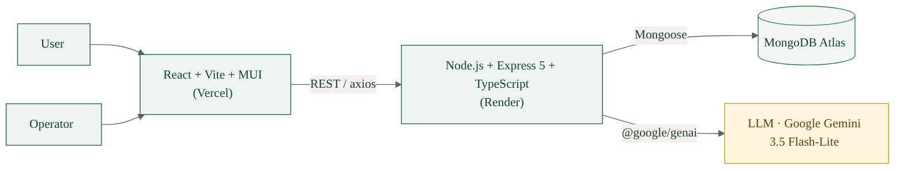
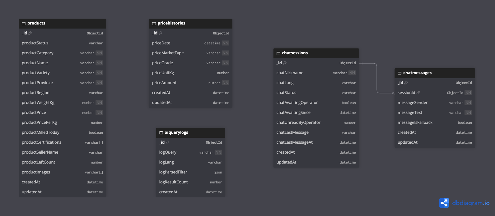

<div align="center">


# KRE AI Market

**LLM 기반 쌀 마켓플레이스 · LLM-powered rice marketplace**

한국미곡거래소(KRE)의 쌀 유통 플랫폼을 모티브로 만든 포트폴리오 프로젝트입니다.<br/>
A portfolio project inspired by the rice trading platform of Korea Rice Exchange (KRE).

🌐 **[kre-ai-market.vercel.app](https://kre-ai-market.vercel.app)** &nbsp;·&nbsp; 🛠 API: [kre-ai-market.onrender.com](https://kre-ai-market.onrender.com/health)

`한국어` · `English` · `Русский` · `O'zbekcha`

</div>

> ⏳ 백엔드는 Render 무료 플랜을 사용합니다. 첫 요청 시 서버가 깨어나는 데 최대 50초가 걸릴 수 있습니다.<br/>
> The backend runs on Render's free plan — the very first request may take up to ~50 s while the server wakes up.

---

## ✨ 주요 기능 · Features

### 1. 🔎 LLM 자연어 검색 · Natural-language search with an LLM
말하듯이 검색하면 **LLM(Google Gemini)** 이 문장을 **검색 조건(JSON)** 으로 바꾸고, MongoDB에서 상품을 찾습니다.<br/>
Type a sentence — an **LLM (Google Gemini)** turns it into a structured filter and the server queries MongoDB.

```
"경기 당일도정 쌀 4만원 이하"
        ↓  LLM · Gemini (structured output)
{ productProvince: "경기", productMilledToday: true, maxPrice: 40000 }
        ↓  MongoDB
4 products
```

- AI가 이해한 조건을 칩(chip)으로 보여 줘서 결과를 투명하게 확인할 수 있습니다.
- 4개 언어로 검색 가능 (`cheapest organic brown rice per kg`, `белый рис 10 кг до 35 тысяч вон` …)
- 16개씩 페이지네이션 · paginated, 16 per page

### 2. 📈 쌀 시세 + LLM 시장 리포트 · Prices & LLM market report
- 20kg 기준 도매/소매 · 상품/중품 가격 추이 차트 (30 / 60 / 90일)
- **숫자는 서버가 계산하고, LLM은 해설만 작성** → 할루시네이션 방지<br/>
  Numbers are calculated on the server; the LLM only writes the commentary — no hallucinated figures.

### 3. 💬 AI 상담 챗봇 · AI help chatbot (Human + LLM)
| 시간 (KST) | 답변 |
|---|---|
| 평일 09:00–18:00 | 👩‍💼 실제 상담원 (상담원 콘솔 `/support/admin`) |
| 상담원이 2분 안에 답하지 못할 때 | 🤖 LLM이 먼저 답변 ("상담원 연결 대기 중" 표시) |
| 그 외 시간 · 주말 | 🤖 LLM이 즉시 답변 (최근 대화 12개를 컨텍스트로 사용) |

> 🧪 **데모 모드 · Demo mode** — 상담 시간을 기다리지 않고 두 모드를 바로 테스트할 수 있도록 상태 카드에 `자동 / 상담원 / AI` 버튼을 두었습니다. 실제 서비스에서는 `SUPPORT_DEMO_MODE` 환경 변수로 끕니다.<br/>
> Lets you try both operator and AI modes at any time. In a real service it is turned off with the `SUPPORT_DEMO_MODE` env variable.

### 4. 🌏 4개 언어 · 4 languages
UI 전체와 LLM 답변이 한국어 / English / Русский / O'zbekcha 를 지원합니다.<br/>
상품 데이터는 DB에 한국어로 한 번만 저장하고, 화면에서 지역·품종·판매처 이름을 번역합니다.

---

## 🧠 기술적 결정 · Engineering decisions

| 문제 · Problem | 해결 · Solution |
|---|---|
| LLM이 자유로운 문장을 반환함 (파싱 불가) | `responseJsonSchema` (structured output) + DB의 실제 지역/품종 목록을 `enum`으로 전달 |
| LLM 응답을 그대로 믿을 수 없음 | `sanitizeFilter()` — 허용된 필드·타입·양수만 통과 |
| 경량 LLM이 가격 조건을 가끔 누락 | **하이브리드**: few-shot 프롬프트 + 정규식 안전망 `extractPriceLimit()` (`4만원 이하`, `under 40k`, `до 35 тысяч`, `40 ming vongacha`) |
| 외부 API 장애 (503 / 429 / 지연) | 재시도 + 모델 fallback + 요청당 타임아웃 + 전체 타임아웃, 동일 질문 1시간 캐시 |
| 서버 위치와 무관한 한국 시간 | `Intl.DateTimeFormat({ timeZone: "Asia/Seoul" })` |
| 상담원 2분 대기 후 AI 전환 | `setTimeout` 대신 **lazy check** — 서버가 재시작돼도 유실되지 않음 |
| 무료 서버 슬립 | `/health` 엔드포인트 + Render health check + uptime 모니터 |
| 이미지 용량 | 800×600 **WebP** (평균 ~50KB) + `loading="lazy"` |

---

## 🏗 아키텍처 · Architecture

<p align="center"></p>

```
router.ts → controllers/*.controller.ts → models/*.service.ts → schema/*.model.ts
```

## 🗂 ER 다이어그램 · Data model

<p align="center"></p>


## 🔌 API

| Method | Endpoint | 설명 |
|---|---|---|
| GET | `/health` | 헬스 체크 |
| GET | `/product/all` | 상품 목록 (필터 · 정렬 · 페이지) |
| GET | `/product/:id` | 상품 상세 |
| GET | `/price/history?days=30` | 가격 이력 |
| POST | `/ai/search` | LLM 자연어 검색 `{ query, lang }` |
| POST | `/ai/report` | LLM 시장 리포트 `{ lang, days }` |
| GET | `/chat/status` | 상담 모드 (상담원 / AI), 한국 시간 |
| POST | `/chat/session` | 채팅 세션 생성 |
| GET · POST | `/chat/:id/messages` · `/chat/:id/message` | 메시지 조회 · 전송 |
| GET · POST | `/support/*` | 상담원 콘솔 (`x-operator-key` 필요) |

---

## 🛠 기술 스택 · Tech stack

**Frontend** — React 19 · TypeScript · Vite · MUI · React Router · react-i18next · Recharts · Axios<br/>
**Backend** — Node.js · Express 5 · TypeScript · Mongoose 9 · MongoDB Atlas<br/>
**AI / LLM** — Google Gemini API (`@google/genai`) · structured output (JSON schema) · prompt engineering (few-shot, system instructions) · LLM output validation · multilingual responses<br/>
**Deploy** — Vercel (client) · Render (server) · Git flow: `develop` → Pull Request → `master`

## 📁 폴더 구조 · Structure

```
Kre-AI-market/
├── server/                 # Express + TypeScript
│   └── src/
│       ├── controllers/    # 요청/응답
│       ├── models/         # 서비스 (비즈니스 로직, Gemini)
│       ├── schema/         # Mongoose 스키마
│       ├── libs/           # enums · types · config · Errors · utils
│       ├── seed/           # 시드 데이터 (31개 상품, 60일 시세)
│       └── router.ts
└── client/                 # React + Vite
    └── src/
        ├── app/
        │   ├── screens/    # marketPage · pricesPage · supportPage · operatorPage
        │   ├── components/ # headers · footer · chat
        │   └── MaterialTheme/
        ├── services/       # API 호출
        └── libs/           # enums · types · i18n (ko/en/ru/uz)
```

## 🚀 로컬 실행 · Run locally

```bash
# 1) Backend — server/.env
#    PORT=3005
#    MONGO_URL=mongodb+srv://...
#    GEMINI_API_KEY=...
#    OPERATOR_PASSWORD=...
#    SUPPORT_DEMO_MODE=true
cd server
npm install
npm run seed      # 상품 31개 + 가격 이력 240건
npm run dev       # http://localhost:3005

# 2) Frontend — client/.env
#    VITE_API_URL=http://localhost:3005
cd client
yarn
yarn dev          # http://localhost:5177
```

---

<div align="center">

Made by **[Edwardd-stack](https://github.com/Edwardd-stack)** · 2026

</div>
